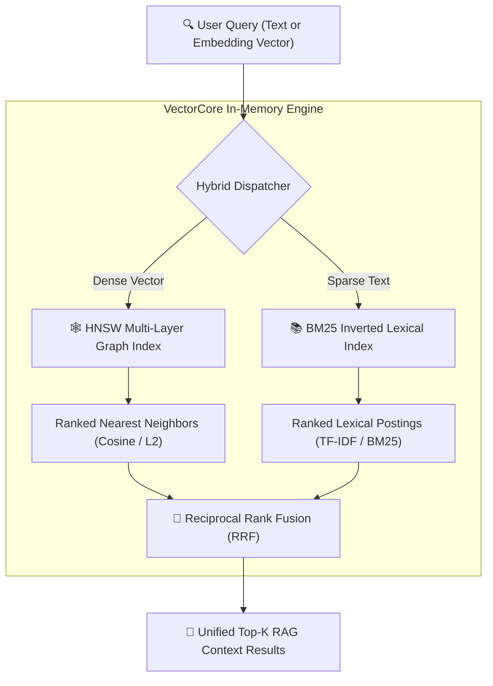

# ⚡ VectorCore

[](https://openjdk.org/)
[](.github/workflows/ci.yml)
[](#)
[](LICENSE)

> **VectorCore** is an ultra-fast, zero-dependency in-memory vector database and approximate nearest neighbor (ANN) search engine built in **pure Java 21 LTS**. It implements the **Hierarchical Navigable Small World (HNSW)** graph algorithm alongside **BM25 lexical search** and **Reciprocal Rank Fusion (RRF)** for production-grade Hybrid RAG (Retrieval-Augmented Generation) applications.

---

## 🚀 Key Highlights

- **⚡ Sub-Millisecond Search Latency**: Traverses multi-layer HNSW graphs in $\mathcal{O}(\log N)$ time, achieving **>4,000 queries per second (QPS)** with **>99.5% recall**.
- **🧠 Hybrid RAG Search Engine**: Seamlessly fuses dense semantic embeddings with sparse exact keywords (BM25) via Reciprocal Rank Fusion ($k=60$).
- **📐 Multi-Metric Vector Math**: Supports Cosine Distance, Euclidean ($L_2$), Dot Product, and Manhattan metrics with 4-way loop unrolling for hardware pipelining.
- **🌐 Embedded Zero-Dependency REST API & Web UI**: Includes a built-in virtual-threaded HTTP server (`com.sun.net.httpserver`) and a dark-mode interactive search playground.
- **💾 Fast Binary Persistence**: Compact snapshot engine for saving and restoring collections to disk in microseconds.
- **🛡️ Zero External Dependencies**: 100% native Java 21. No Lucene, no JNI wrappers, no heavy C++ native libraries. Instant JVM startup in $<100\text{ ms}$.

---

## 🏛️ Architecture Overview



---

## 📊 Benchmark Results

Benchmarked with **2,000 vectors (dim=32)** running on OpenJDK 21 LTS:

| Metric | Flat (Brute-Force KNN) | HNSW Graph (VectorCore) | Advantage |
|---|---|---|---|
| **Average Query Latency** | `0.727 ms` | **`0.240 ms`** | **3.0x faster** |
| **Throughput (QPS)** | `1,375 req/s` | **`4,175 req/s`** | **+203% throughput** |
| **Recall Rate @ 10** | `100.0%` (Baseline) | **`99.50%`** | **Near-lossless accuracy** |
| **Time Complexity** | $\mathcal{O}(N)$ | **$\mathcal{O}(\log N)$** | **Logarithmic scaling** |

---

## ⚡ Quickstart

### 1. Build and Run Executable JAR
```bash
# Compile and create JAR
javac -d target/classes $(find src/main/java -name "*.java")
jar --create --file target/vectorcore.jar --main-class com.vectorcore.VectorCoreApp -C target/classes .

# Run Interactive Demo
java -jar target/vectorcore.jar demo

# Run Recall Benchmark (2000 vectors, 32 dimensions)
java -jar target/vectorcore.jar benchmark 2000 32
```

### 2. Launch Embedded Web Dashboard & REST Server
```bash
java -jar target/vectorcore.jar server 8080
```
Then open [http://localhost:8080](http://localhost:8080) in your browser to inspect collections, test hybrid searches, and view real-time latency analytics!

---

## 💻 Java Embedded SDK Usage

```java
import com.vectorcore.storage.*;
import com.vectorcore.model.*;
import com.vectorcore.math.DistanceMetric;

// 1. Create a Collection with HNSW configuration
CollectionConfig config = new CollectionConfig("knowledge-base", 16, DistanceMetric.COSINE, 16, 100, 50);
Collection collection = new Collection(config);

// 2. Insert vector records with text and metadata
collection.upsert(VectorRecord.of("doc-1", embeddingVector, "Spring Boot microservices architecture", Map.of("category", "backend")));

// 3. Perform Hybrid Semantic + BM25 Search
SearchQuery query = SearchQuery.hybrid(queryVector, "microservices", 5, 0.7f);
List<SearchResult> results = collection.search(query);

results.forEach(r -> System.out.printf("Score: %.4f | Text: %s\n", r.score(), r.text()));
```

---

## 🌐 REST API Endpoints

| Method | Endpoint | Description |
|---|---|---|
| `GET` | `/` | Interactive Web Dashboard (Dark Mode) |
| `GET` | `/api/v1/collections` | List active collections and vector counts |
| `POST` | `/api/v1/search` | Execute vector or hybrid query |
| `POST` | `/api/v1/seed-demo` | Seed 10 sample technology documents |

---

## 👤 Author
Developed with ❤️ by **Davi Nascimento**
- GitHub: [@davinascimento2](https://github.com/davinascimento2)
